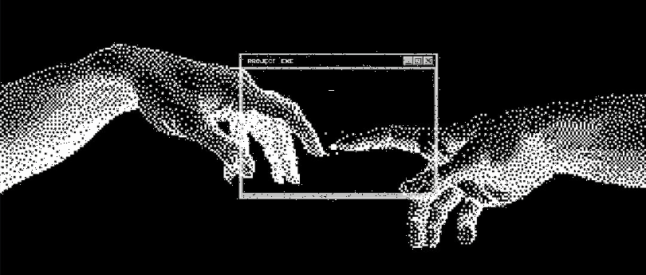
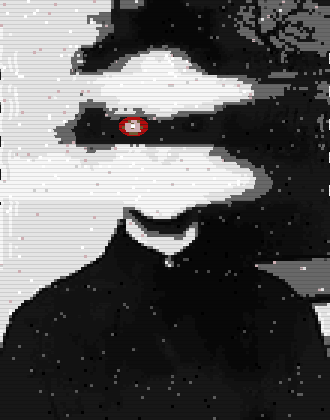

<!-- ================= BANNER ================= -->

  

<!-- ================= HEADER ================= -->
<h1 align="center">Hi 👋, I'm Arva aka SORA</h1>

<h3 align="center">Monitoring Engineer · Automation Enthusiast</h3>

  

  Turning repetitive ATM/CRM monitoring work into small, reliable automation tools.

<!-- ================= ABOUT ME ================= -->
<h2 align="center">🚀 About Me</h2>

**Arva**, here — I work in **ATM/CRM monitoring** for a bank, watching problems across several platforms every day.

Instead of clicking the same screens over and over, I started **learning programming by solving my own work problems** — with AI as my mentor.

Currently, I'm building **SORA Studio**, a Claude Code-powered short-video studio where 14 AI agents work in 7 paired divisions, plus **SAKATO WATCH** (a Tampermonkey userscript for unified ATM monitoring) and **SOVA** (a Python/PySide6 desktop app for photo location & time watermarks), while learning **JavaScript, Python, and Google Apps Script**.

My goal is simple: automate the boring stuff, build tools people actually use, and grow into a software engineer who ships things that last.

 

<!-- ================= FEATURED PROJECTS ================= -->
<h2 align="center">🧪 Featured Projects</h2>

<table align="center">
  <tr>
    <td width="50%" valign="top">
      <h3>😈 SAKATO WATCH</h3>
      
One Tampermonkey userscript that watches <b>5 ATM monitoring platforms</b> at once — new-ticket alerts with a different sound per platform, a draggable floating button, and a session guardian that keeps logins alive.

      
<code>JavaScript</code> · <code>Tampermonkey</code> · <code>Web Audio</code>

    </td>
    <td width="50%" valign="top">
      <h3>🔥 SORA Studio</h3>
      
An automated short-video studio run by one orchestrator and 14 AI agents in 7 paired divisions. Every video passes three human gates, and the voice-over is always made by hand in ElevenLabs.

      
<code>Claude Code</code> · <code>Remotion</code> · <code>three.js</code> · <code>Python</code> · <code>FFmpeg</code>

      
<a href="https://github.com/nikiaaaa/Hell-">View repo →</a>

    </td>
  </tr>
  <tr>
    <td width="50%" valign="top">
      <h3>📸 SOVA</h3>
      
A Windows desktop app that stamps <b>location &amp; time</b> onto field photos, using a coordinates sheet of ATM sites so reports look clean and consistent.

      
<code>Python</code> · <code>PySide6</code> · <code>Excel</code>

    </td>
    <td width="50%" valign="top">
      <h3>🛠️ TechSO</h3>
      
A field-service operations platform for ATM/CRM maintenance: scheduler-assigned dispatch, SLA monitoring, a live technician map, evidence-backed reports, and a technician mobile app with offline support. Demo data only.

      
<code>FastAPI</code> · <code>React</code> · <code>TypeScript</code> · <code>SQLAlchemy</code>

      
<a href="https://github.com/nikiaaaa/Tech-SO">View repo →</a>

    </td>
  </tr>
  <tr>
    <td width="50%" valign="top">
      <h3>🎬 Cartoon Short Director</h3>
      
A Claude skill that directs a vertical cartoon short from idea to script to per-scene plan to ready-to-paste scene prompts.

      
<code>Claude Skill</code> · <code>Prompting</code> · <code>Storyboarding</code>

      
<a href="https://github.com/nikiaaaa/cartoon-short-director">View repo →</a>

    </td>
    <td width="50%" valign="top">
      <h3>🧊 Cartoon 3D Short</h3>
      
A Claude skill that renders ~60 s vertical cartoon stories: 2D bean-head characters in a 3D world, with synthesized SFX and music. Based on an MIT-licensed project.

      
<code>Claude Skill</code> · <code>Remotion</code> · <code>three.js</code> · <code>FFmpeg</code>

      
<a href="https://github.com/nikiaaaa/carrtoon-3d-short">View repo →</a>

    </td>
  </tr>
</table>

SORA Studio, TechSO, and the two Claude skills are public. SAKATO WATCH and SOVA are private for now. More to come.

<!-- ================= CONNECT ================= -->
<h2 align="center">🤝 Connect</h2>

  
  &nbsp;
  

<!-- ================= TECH STACK ================= -->
<h2 align="center">💻 Tech Stack</h2>

  

<!-- ================= GITHUB STATS ================= -->
<h2 align="center">📊 GitHub Stats</h2>

  

<!-- ================= ACTIVITY GRAPH ================= -->
<h2 align="center">📈 Activity Graph</h2>

  

<!-- ================= FOOTER ================= -->

  

<i>Stay curious. Stay glitchy. 🖤</i>

